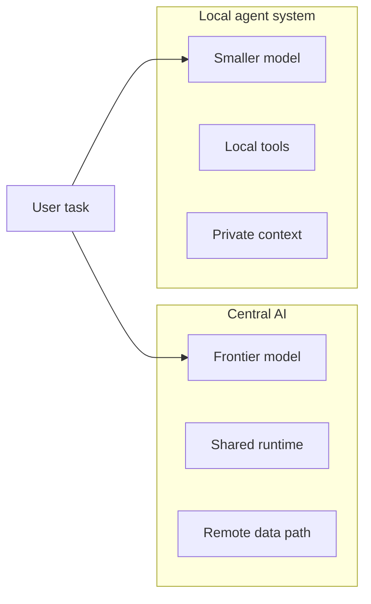
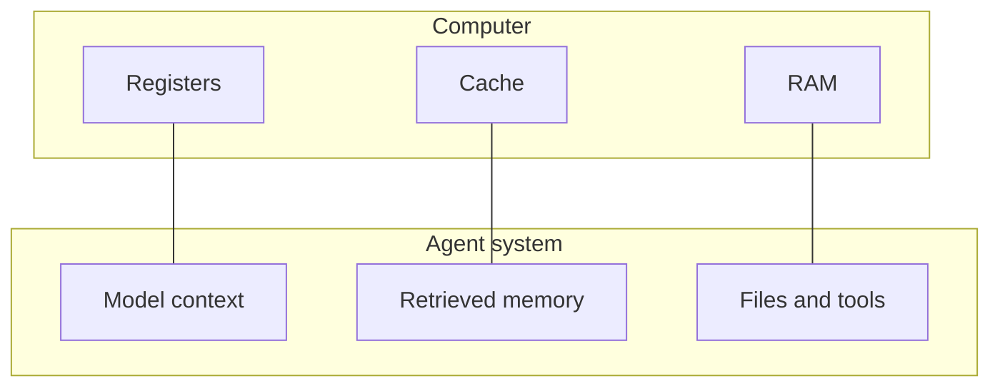
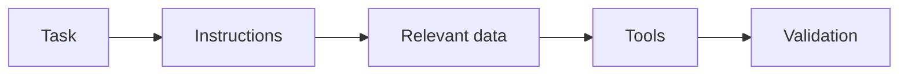
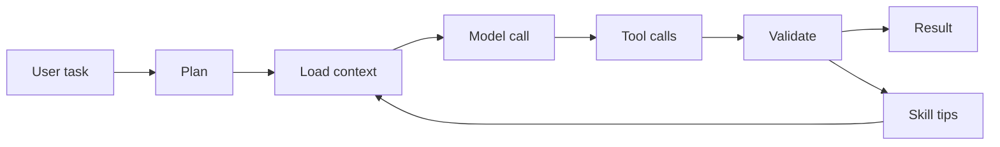
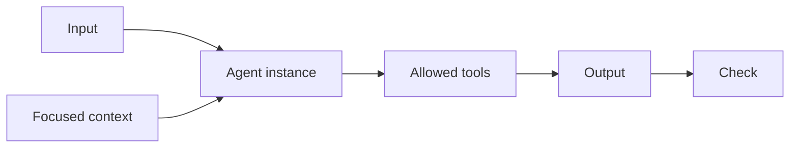
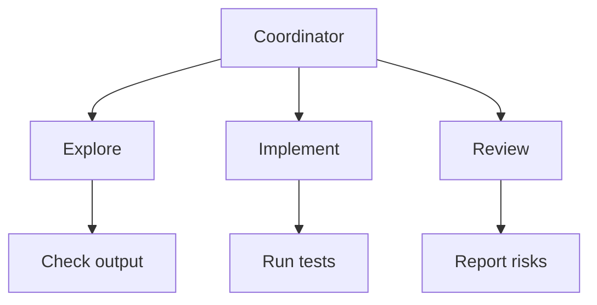
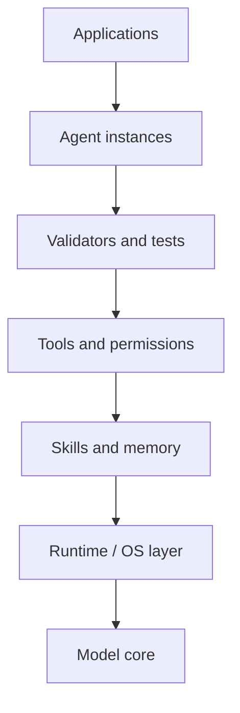

LLMs are getting larger, more capable, and more expensive. The obvious story is that this continues: larger models, larger clusters, larger data centers.

That may be part of the future. But as an engineer trying to build useful systems, I find another analogy more helpful: AI may follow some of the same pressure gradients as computing itself.

Computers did not become useful only because central machines became larger. They became useful because the stack around the processor changed: cheaper chips, personal computers, operating systems, compilers, libraries, and eventually networks of machines with different jobs.

I do not mean this as a neat one-to-one prediction. History is messier than that. But it gives us a useful engineering question:

> What if the next gains in AI come less from making one model know everything, and more from building the system around it well?

There are three comparisons I want to separate:

1. Central machines to local intelligence: where useful compute runs.
2. CPUs to models: how expensive cores are surrounded by memory, devices, and software.
3. Function calls to agents: how complex work is bounded, checked, and composed.

The operating-system analogy sits across those comparisons. If the model is the core, the agent runtime is the layer that decides what gets loaded, what gets permission, how work is isolated, and how failures are recovered.

## From Central Machines to Local Intelligence

The current LLM world still has a mainframe shape. A few very capable centralized systems serve many users. They are expensive to train, expensive to run, and operated by a small number of organizations.

Mainframes did not disappear. They are still useful where centralization makes sense. But the center of gravity changed when microprocessors became cheap enough and software became good enough. The PC did not win by being stronger than every mainframe. It won because it changed the economics and ergonomics of computing: ownership, latency, and programmability.

Something similar may happen with AI.

Cloud models will remain important. Some tasks really do need the strongest available model. But many tasks need a different shape of compute: something close to the user's files, private context, local tools, and feedback loop. A model that is merely good enough can become much more useful when it is allowed to operate near the work.

That shifts attention from "the smartest model" to the local agent system around it. The question becomes less abstract: can this system find the relevant repository files, call the right API, make a scoped edit, run the test that matters, and show evidence that the result worked?

The practical goal for the next few years may be efficiency as much as raw intelligence. Not just "how do we scale the model?", but "how do we spend fewer tokens, less latency, and less human attention per useful result?"

## The Model Is Not the Product

As systems get more complex, they stop being a single magic box. They become layered. We see this everywhere in computing: processors below operating systems, operating systems below applications, and network stacks split into layers because no one wants every program to reason about voltage, packets, routing, TLS, and retries at once.

An LLM is closer to a compute core than to a complete computer.

That sounds strange because an LLM can write text, reason about code, and call tools. But a processor is also only impressive once it is placed inside a system. A CPU without memory, devices, a scheduler, and an operating system is not a useful product for most people. It is a powerful component waiting for the rest of the machine.

A raw model call is similar. It is powerful, but it is not yet a reliable software system.

The clearest comparison is working memory. CPU registers are tiny and precious, so software constantly decides what belongs in registers, cache, and RAM. We do not try to put the whole program state into registers. We build a memory hierarchy.

LLM context has the same pressure. More context helps, but it is not free. Larger context windows cost more, increase latency, and can make attention harder to spend well. A good agent runtime should treat context as scarce working memory, not as a place to dump everything.

The runtime needs to decide what to load:

This is not glamorous, but it matters. A smaller model with the right context and tools can beat a larger model drowning in irrelevant information.

There is also a parallel with instruction sets. CPUs did not become more useful only by adding more instructions forever. Complexity moved between hardware and software. Better compilers, runtimes, and operating systems made simpler cores useful.

LLMs may follow a similar path. Instead of expecting one giant model to internalize every API, repository convention, and local workflow, we can move some complexity into the runtime: retrieval, tool schemas, custom interfaces, and review loops. That is one reason I am exploring [`CogCore`](https://github.com/carsonDB/CogCore): the system should not need the model weights to memorize every project-specific habit. It should be able to expose those habits externally, through tools and runtime behavior.

This does not mean model quality stops mattering. Better models make everything easier. The point is narrower: once a model is capable enough, the system around it can dominate the result.

## The Runtime Is the Operating System

If the model is a compute core, the agent runtime is closer to an operating system.

An operating system does not make the CPU omniscient. It manages scarce resources. It isolates work. It exposes stable interfaces to files, devices, networks, and permissions, so every program does not need to control the whole machine directly.

An agent runtime should do similar work for model calls, tools, memory, and permissions. It should decide what context enters the prompt, which tools are available, which actions require confirmation, and how failed attempts are rolled back or retried.

This loop is more important than any single prompt. The runtime decides what the model sees, what tools it may use, how outputs are checked, and what can be reused next time.

Skills fit naturally into this layer. Computers use caches because repeated work has structure. The same idea appears at many levels: CPU caches keep recently used data nearby, compilers reuse analysis, and libraries package patterns that should not be rewritten every time.

Agent skills are a software-level version of that idea. A skill is not a guarantee of correctness. It is more like a cached engineering habit: for this task, inspect these files first; use this parser; run this test before returning. It makes the runtime more familiar with work it sees repeatedly, without pretending the model weights have changed.

That knowledge can become stale, so it should not be trusted blindly. But it can reduce search space dramatically. Humans work this way too. A senior engineer is not useful because they memorized every answer. They are useful because they carry good starting points and know when to verify.

So skills are mainly an efficiency layer, not an accuracy guarantee. Reliability still comes from the checks around the model, not from pretending a smarter model cannot fail.

## Agents as Bounded Units of Work

Once the runtime can manage context, permissions, and validation, the next question is how to package the work itself. The smallest useful unit in this stack may look less like a chat session and more like a function call.

In ordinary software, a function has inputs, local state, side effects, and outputs. Tests and type checks sit around it. We split programs into functions because smaller boundaries make complex behavior easier to reason about.

An agent instance can be treated the same way.

This is where multiple agents become useful, not as stage dressing, but as software structure.

A complex task often contains different kinds of work: exploration, implementation, and review. Giving all of that to one huge context can work for small jobs, but it becomes fragile as the task grows. The coordinator starts carrying too many details, and each new tool call increases the chance that unrelated state leaks into the next decision.

A tree of agent instances gives the work clearer boundaries. One agent can inspect a dependency without permission to edit files. Another can make a narrow change. A reviewer can receive the diff and the stated intent, then report risks without inheriting the whole conversation history. The goal is not "more agents" as a feature. The goal is smaller units whose inputs, outputs, and permissions are easier to inspect.

The security story also improves with boundaries. A single large agent with broad tool access has a large blast radius. Smaller agent units can be gated. Their inputs can be sanitized. Their outputs can be reviewed. Their permissions can match the job.

This looks familiar if you squint at ordinary software testing. Unit tests check small pieces. Integration tests check how pieces cooperate. End-to-end tests check the user-visible path. Agent systems need similar layers of confidence: local checks for narrow outputs, integration checks for tool use, and final validation for the actual task.

That does not magically make agent systems safe. It gives us familiar places to put controls.

## What This Changes in Practice

The architecture I would bet on is not "one model to rule everything". It is a layered system:

For a coding agent, reliability does not come only from knowing more JavaScript. It comes from reading the repository before editing, respecting existing patterns, using structured parsers where possible, running the right tests, and keeping changes scoped. Those are runtime behaviors as much as model behaviors.

This is the direction I am exploring in [`CogCore`](https://github.com/carsonDB/CogCore): not a claim that agent runtimes are solved, but a bet that the useful work is moving into the layer around the model.

## A Humble Guess

I do not think small local models simply replace frontier models. The history of computing kept both centralized and distributed systems. We still have cloud databases, supercomputers, laptops, and phones.

AI will probably be similar. Some work belongs in frontier-scale centralized models. Some belongs on-device. A lot of useful work will sit between them, coordinated by runtimes that decide where each piece should execute.

The interesting engineering challenge is to make agents less like clever demos and more like reliable programs. That probably requires fewer grand claims and more ordinary machinery: memory hierarchy, process boundaries, tool contracts, and validation.

That is the part I find exciting. If LLMs are the new compute core, we are still early in building the operating systems around them.
